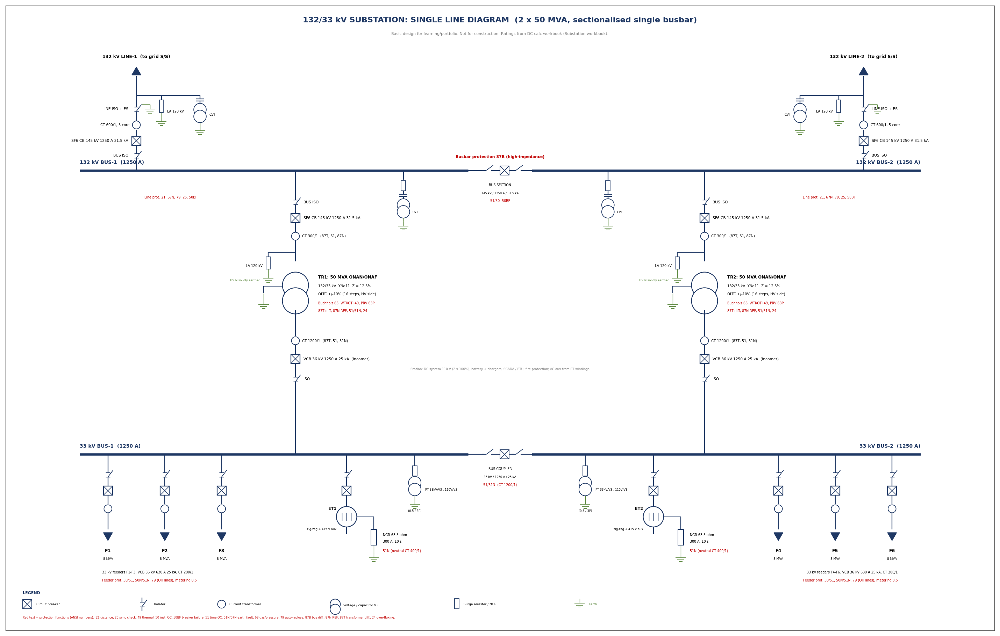

# 132/33 kV Substation Design

Electrical design of an outdoor 132/33 kV substation: scheme selection, transformer sizing, short-circuit study, equipment ratings, protection settings, earthing grid and single line diagram.

> **Status:** Basic design for learning and portfolio use. Grid fault level and soil resistivity are **assumed**. Not for construction.

## Design Basis

| Parameter | Value |
|---|---|
| Voltage levels | 132 kV (Um 145 kV) and 33 kV (Um 36 kV), 50 Hz |
| Supply | 2 x 132 kV incoming lines, grid fault level 4000 / 2500 MVA max / min (assumed) |
| Transformers | 2 x 50 MVA ONAN/ONAF, YNd11, Z = 12.5%, OLTC +/-10% |
| Load | 6 x 33 kV feeders of 8 MVA, diversity 0.85, 20% growth |
| Scheme | Sectionalised single busbar at both voltage levels |
| Reliability | N-1: loss of either transformer or line without loss of load |
| 33 kV neutral | Zig-zag earthing transformer + 63.5 ohm NGR, earth fault limited to 300 A |

## Key Results

| Area | Result |
|---|---|
| Design load (with growth) | 49 MVA, transformer N-1 loading 98% |
| Fault level, 132 kV bus | 17.5 kA (breaker rating 31.5 kA / 3 s) |
| Fault level, 33 kV bus | 12.9 kA (breaker rating 25 kA / 3 s) |
| Hand calc vs pandapower | Agreement within 0.1% |
| OC / EF grading margins | All above 0.3 s |
| Earthing grid | Rg = 0.73 ohm, touch 621 V < 706 V, step 913 V < 2353 V (all pass) |

## Repository Contents

| File | Description |
|---|---|
| `Substation_132_33kV_Report.docx` | Full design report (10 sections) |
| `Substation_132_33kV_Design.xlsx` | Calculation workbook with live formulas |
| `Substation_SLD.png` | Single line diagram (image) |
| `Substation_SLD.dxf` | Single line diagram (CAD file, opens in AutoCAD / LibreCAD) |

### Workbook sheets

`Summary` | `Inputs` | `Transformer` | `ShortCircuit` | `Equipment` | `Protection` | `Earthing` | `BOM` | `Std`

## Scope

**Covered:** scheme selection, transformer rating and neutral earthing, IEC 60909 short-circuit study, busbar / breaker / isolator / CT / PT / arrester ratings, protection scheme and settings (21, 87T, 87B, 51/51N), IEEE 80 earthing design, equipment list.

**Not covered:** civil and general-arrangement layout, cable sizing, auxiliary AC/DC design, SCADA, fire protection, load flow, detailed insulation coordination and lightning shielding.

## Standards Referenced

IEC 62271-100 / -102, IEC 61869, IEC 60099-4, IEC 60071, IS 2026 / IEC 60076, IEC 60909, IEEE 80, IS 3043, CBIP manuals, CEA regulations.

## Tools

- Microsoft Excel (live formulas)
- Python / pandapower (short-circuit cross-check)
- Python (drawing and curves)

ETAP and AutoCAD were **not** used. The DXF file is generated by Python.

## Limitations and Next Steps

- Replace assumed grid data with real utility data (including zero-sequence).
- Run a Wenner four-pin soil survey. The grid **fails** above about 150 ohm.m at 5 m spacing.
- Repeat short-circuit, relay coordination and ground grid studies in ETAP.
- Redraw the SLD in AutoCAD with title block, and add a general-arrangement drawing.

## Author

Mohit ([@mohit1631](https://github.com/mohit1631))

## License

MIT License
